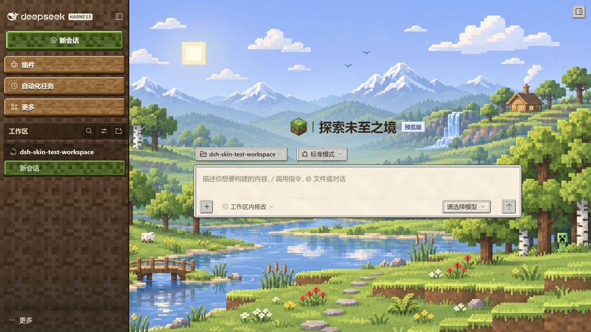

# MC valley for DSH

为 DeepSeek Harness Web 客户端添加像素山谷、木质导航、纸面面板与草绿色控件的主题插件。
皮肤素材随插件内联，运行时不从第三方下载图片。



这是独立的粉丝作品，并非 Minecraft 官方产品，与 Mojang 或 Microsoft 无关联。

## 兼容性

- 已实测：Ubuntu WSL 2，DSH Web `0.2.2-rc.1`，Windows 浏览器，Node.js `24.18.0`。
- 目前安装清单仅声明支持 DSH `0.2.2-rc.1`。界面使用部分宿主 CSS Module 类名，
  即便版本号相同，不同构建也可能不同；其他版本需要额外验证。
- 主题改变界面外观，不提供模型或账号服务。聊天仍需按 DSH 自身要求配置模型。
- 如果之前安装过其他版本的本皮肤，请先停用或卸载旧版本，避免两套主题同时覆盖。

## 从 GitHub 安装

需要已安装 DSH 和 `pnpm`。下例在 Ubuntu / WSL 终端执行；Windows 用户可克隆仓库后，
在 DSH 插件管理界面安装本地目录。执行前请退出正在运行的目标 Web profile。

```bash
git clone https://github.com/Imccark/dsh-mc-valley.git
cd dsh-mc-valley
dsh plugin --profile web add "$(pwd)"
dsh web
```

用浏览器打开 DSH 打印的完整地址，在「插件」中确认 **MC valley for DSH** 已启用。
如果使用自定义 profile，将上面的 `web` 换成对应名称。

## 卸载

退出对应 DSH Web 后执行：

```bash
dsh plugin --profile web remove dsh-mc-valley
```

也可以在 DSH 的插件管理界面停用或移除。停用时皮肤样式及其主题覆盖会被移除。

## 本地构建与检查

构建脚本只使用 Python 标准库。下列命令使用 `uv`，不会在项目内创建 `.venv`：

```bash
uv run --no-project --python 3.11 python -B scripts/build_plugin.py
uv run --no-project --python 3.11 python -B scripts/build_plugin.py --check
uv run --no-project --python 3.11 python -B scripts/test_dsh_wsl_compat.py
node scripts/test_skin_lifecycle.mjs
npm pack --dry-run --ignore-scripts
```

兼容性测试默认不需要本机 DSH；若要对照已安装的 Linux 组件，可将环境变量
`DSH_LINUX_NODE_MODULES` 指向该安装的 `node_modules/@deepseek-ai`。生成精灵或字体的
可选脚本另需 Pillow 或 fontTools；构建发布包不需要安装它们。

源样式在 `skin/src/`，材质在 `skin/sprites/`，`client.js` 由构建脚本生成。
不要直接编辑生成的 `client.js`。

## License / 许可

项目代码采用 [MIT](LICENSE)。字体、DSH 类名映射及插画来源说明见
[THIRD_PARTY_NOTICES.md](THIRD_PARTY_NOTICES.md)。

---

An independent pixel-art valley theme for the DeepSeek Harness Web client.
Tested on DSH Web `0.2.2-rc.1` in Ubuntu WSL 2. This is an unofficial fan
project, not approved by or associated with Mojang or Microsoft.
